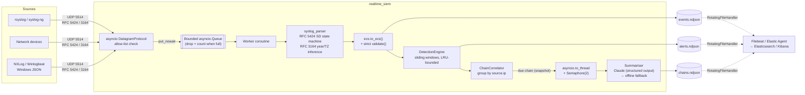

# Project 01 · Real-Time AI-SIEM: Architecture Defense

## 1. The SOC problem

The baseline analyser read static log files after the fact. In a live SOC, that has three problems:

1. **Latency.** A brute force that succeeds at 02:14 and adds a backdoor account at 02:18 has to be seen at 02:14, not when someone uploads a file the next morning.
2. **Schema chaos.** Every source formats logs differently, so detections, dashboards and hunts get rewritten for each one. Analysts lose time translating fields instead of investigating.
3. **Alert fatigue.** Four separate alerts (brute force, login, sudo, useradd) are really one intrusion. A Tier-1 analyst has to rebuild that story by hand under time pressure.

This project receives syslog in real time, puts every event into one standard schema (ECS), detects attacks as the events arrive, links related alerts into one chain, and has an LLM explain each chain in plain English. Detection itself is deterministic and never depends on the LLM.

## 2. Data flow

## 3. Component decisions and why

| Concern | Choice | Why this over the alternatives |
|---|---|---|
| Network ingest | `asyncio.DatagramProtocol` on UDP | Uses only the standard library and needs one thread for thousands of datagrams per second. `socketserver.ThreadingUDPServer` would start one thread per datagram, which falls over during exactly the kind of log flood an attack causes. |
| Back-pressure | Bounded `asyncio.Queue` + `put_nowait` | UDP has no flow control, so the queue has to drop something when it fills. Dropping at a fixed cap and counting the drops in `dropped_queue_full` keeps memory bounded and makes the overload visible. An unbounded queue would quietly run the process out of memory. |
| Syslog parsing | A hand-written RFC 5424 STRUCTURED-DATA state machine, plus regex for headers | SD values can contain escaped `"`, `\` and `]`, which regex cannot parse correctly. Parsing never raises: a malformed datagram still becomes an ECS event tagged `_syslog_parse_failure`, so no evidence is thrown away. |
| Time handling | RFC 3164 year and zone inferred from arrival time, with Dec→Jan rollover. Everything is stored in UTC. | BSD syslog has no year or zone. Mixing local and UTC timestamps is one of the most common causes of a broken incident timeline. |
| Schema | **ECS 8.11**, enforced by `ecs.validate()` on every document | ECS is the vendor-neutral standard behind Elastic Security, and other SIEMs map to it. The validator rejects any field that is not declared ECS (or the declared `siem.*` custom namespace), checks types (`ip`, `date`, `long`…) and checks ECS allowed values for `event.kind/category/type/outcome`. That is what "strictly ECS" means in practice: a mapping bug fails a unit test instead of polluting the index. |
| Detection | Streaming, stateful rules over per-entity `deque` windows | Each event costs O(1) amortised, and nothing is re-scanned in batches. State lives in `BoundedDict`, an LRU capped at `max_tracked_keys`, so a flood of spoofed source IPs cannot exhaust memory. Cooldowns per `(rule, entity)` prevent alert storms. |
| Correlation | Chains keyed on `source.ip`. The post-compromise rule copies the attacker IP onto host-level alerts. | That one key turns brute force → login → sudo → useradd into a single chain. The chain is summarised again only when it escalates in severity or after a debounce, which keeps LLM spend proportional to real activity. |
| Disk management | `logging.handlers.RotatingFileHandler`, one per stream | Disk use is capped at `max_bytes × (backups + 1)` per stream. Separate streams mean high-volume raw events can never rotate alerts out of retention. NDJSON is the format Filebeat, Elastic Agent, `jq` and bulk loaders all read. |
| LLM | Anthropic Claude (`claude-opus-5-5`) using **structured outputs** (`output_config.format` JSON schema) | The schema guarantees parseable output with `verdict` and `attack_stage` restricted to an enum, so the result goes straight into ECS fields without fragile text parsing. Effort is configurable (`LLM_EFFORT`) so cost and latency can be tuned. |
| LLM safety | `<alert_chain>` data fence, fence-escape neutralisation, optional pseudonymisation (`LLM_REDACT`) | Usernames and command lines can be controlled by the attacker, which makes them a classic route for prompt injection. Pseudonymisation keeps internal usernames and hostnames inside the network. |
| LLM resilience | Token-bucket rate limit, circuit breaker, typed error handling, `refusal` handling, server-side `fallbacks: "default"` | Configuration errors (401/403/404/400) trip the breaker immediately. Transient errors (429/5xx/network) count towards it. A refusal or any failure falls back to the deterministic `OfflineSummarizer`, so a chain is **always** summarised. An API outage costs explanation quality, never a detection. |
| Thread safety | The chain is snapshotted on the event-loop thread, then summarised in a worker thread | The worker keeps appending to the live chain while Claude is thinking. The immutable `ChainSnapshot` removes that race. |

## 4. Detection rules

| Rule | Logic | ATT&CK | Severity |
|---|---|---|---|
| `SIEM-AUTH-001` | ≥ `DETECT_BRUTE_FORCE_THRESHOLD` auth failures from one `source.ip` in `DETECT_BRUTE_FORCE_WINDOW_S` | T1110.001 | high (73) |
| `SIEM-AUTH-002` | Successful auth from a source that tripped AUTH-001 inside the window | T1110.001, T1078 | critical (99) |
| `SIEM-AUTH-003` | ≥ `DETECT_SPRAY_USER_THRESHOLD` distinct usernames failing from one source | T1110.003, T1087 | high (73) |
| `SIEM-PRIV-001` | sudo, account creation, group change or Windows 4672/4720/4732 on a host within `DETECT_POST_COMPROMISE_WINDOW_S` of an AUTH-002 on that host | T1548.003, T1136.001, T1098 | critical (99) |

Severity scores follow Elastic Security's 21/47/73/99 convention.

## 5. ECS field map (syslog → ECS)

| Source | ECS field |
|---|---|
| PRI | `log.syslog.priority`, `log.syslog.facility.{code,name}`, `log.syslog.severity.{code,name}`, `log.level` |
| VERSION / HOSTNAME / APP-NAME / PROCID / MSGID | `log.syslog.version`, `log.syslog.hostname` + `host.hostname` + `host.name`, `log.syslog.appname` + `process.name`, `log.syslog.procid` + `process.pid`, `log.syslog.msgid` |
| STRUCTURED-DATA | `log.syslog.structured_data` |
| TIMESTAMP (or arrival time) | `@timestamp`. Arrival time is `event.created`, processing time is `event.ingested` |
| Raw datagram | `event.original` |
| Sender address | `labels.syslog_peer_ip`, `labels.syslog_peer_port` |
| sshd `Failed/Accepted … for U from IP port P` | `event.category:[authentication]`, `event.type:[start]`, `event.outcome`, `event.action:ssh_login`, `user.name`, `source.ip`, `source.port` |
| sudo `U : … USER=E ; COMMAND=C` | `event.category:[process]`, `user.name`, `user.effective.name`, `process.command_line`, `process.working_directory` |
| useradd / usermod | `event.category:[iam]`, `user.target.name`, `group.name` |
| Windows JSON (4624/4625/4672/4720/4732) | `event.code`, `event.provider`, `user.name`, `user.domain`, `source.ip`, `host.hostname` |
| Alerts | `event.kind:alert`, `rule.*`, `threat.framework`, `threat.tactic.*`, `threat.technique.*`, `event.severity`, `event.risk_score` |
| Chain summaries | `siem.chain.*` (a declared custom namespace, as ECS guidance recommends for custom data) |

## 6. Failure modes and how they are handled

| Failure | Behaviour |
|---|---|
| Datagram flood beyond worker capacity | Queue fills, excess is dropped and counted in `dropped_queue_full`, and stats are logged every `SIEM_STATS_INTERVAL_S` |
| Malformed or binary datagram | Becomes an ECS event tagged `_syslog_parse_failure`. Never raises |
| A bug while processing one datagram | The exception is logged and the worker carries on (tested by `test_poison_datagram_does_not_kill_worker`) |
| Claude unavailable, rate limited, refused or returns bad output | The offline summary is written with `siem.chain.llm.fallback_reason` set, so the degradation can be audited |
| Disk pressure | Rotation caps each stream, and the oldest backup is deleted first |
| SIGINT/SIGTERM | The listener closes, the queue drains (10 s budget), pending summaries finish, files flush, and final stats are logged |

## 7. Scaling path

A single process sustains several thousand events per second, which covers a departmental SOC. Past that, the receiver runs behind a UDP load balancer as N stateless replicas, with consistent hashing on source IP so per-entity detection state stays on one replica. The NDJSON files are shipped by Filebeat, and the same `to_ecs()` code can sit behind a Kafka consumer without changes.
