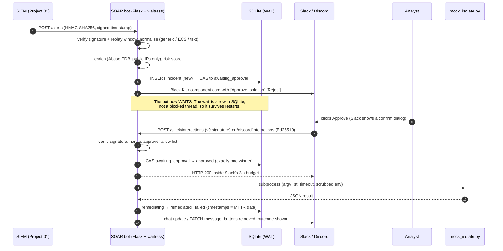

# Project 02 · HitL SOAR Bot: Architecture Defense

## 1. The SOC problem

Fully automated containment is fast, but it is also dangerous. A false positive that isolates a domain controller or a production database is an outage the security team caused. Fully manual containment is safe, but slow: the analyst has to pivot to the EDR console, find the host, and click through. That delay is where attackers move laterally.

**Human-in-the-Loop (HitL) SOAR** sits between the two. The machine does everything except the decision: enrichment, scoring, preparing the exact action. A named, authorised human then makes the decision with one click, in the chat tool they already have open. The bot measures how long each stage takes (MTTA, approval latency, time-to-contain, MTTR), so the team can show improvement with numbers.

## 2. Flow

## 3. Design decisions

| Concern | Decision | Why |
|---|---|---|
| Waiting for the human | Durable state machine in SQLite (`new → awaiting_approval → approved → remediating → remediated/failed`, plus `rejected`, `expired`, `closed`) | A blocked thread or in-memory future is lost on restart and pins a worker for up to an hour. A row costs nothing, survives redeploys, and gives a complete timeline for MTTR. |
| Exactly-once execution | Every transition is a compare-and-set: `UPDATE … WHERE id=? AND status=?` | Slack retries callbacks, analysts double-click, and two approvers can click at once. Only one `awaiting_approval → approved` transition can succeed, and only that path queues the script. `test_concurrent_approvals_have_exactly_one_winner` fires 8 simultaneous approvals and asserts one winner. |
| Who may approve | Allow-list of Slack or Discord user IDs (`*_APPROVER_IDS`). Config refuses to start a chat mode without one | Separation of duties. Being in the channel is not the same as being authorised to isolate production hosts. Refused attempts are written to the audit log with the user's name. |
| Forged or replayed clicks | Slack v0 HMAC with a 5-minute timestamp window, Discord Ed25519, and a per-incident random nonce in the button value, compared in constant time | The signature proves the request came from Slack or Discord. The nonce proves the click was made on *this* incident's card. |
| Inbound alerts | HMAC-SHA256 over `"<timestamp>.<body>"` with a 5-minute skew, and a 256 KiB body cap | A captured request cannot be replayed later, and anyone without the key cannot open incidents. |
| Remediation execution | Separate script, argv list (never `shell=True`), host and IP validated twice, hard timeout, child environment scrubbed of secrets | Alert fields are attacker-influenced, so a hostname like `web01; rm -rf /` must never reach a shell. The child never sees `SLACK_BOT_TOKEN`, and a test proves it. Swapping the mock for a real EDR call (CrowdStrike RTR, Defender `isolate`) changes one file. |
| Audit | Append-only `audit_log`, enforced by SQLite triggers **and** a SHA-256 hash chain, with `/audit/verify` | The triggers stop accidental or casual edits. The hash chain catches an attacker who has file access and drops the triggers. `test_audit_chain_detects_tampering` does exactly that. |
| MTTR model | Separate timestamps: `detected_at` (taken from the SIEM's `event.start`, not arrival time), `approval_requested_at`, `decided_at`, `remediation_started_at`, `resolved_at` | One "MTTR" number hides where the time goes. Splitting it shows whether the bottleneck is people (approval latency) or tooling (time-to-contain). Reports give mean, median and nearest-rank p90, overall and per severity. |
| Chat UX | Slack Block Kit with a **confirm dialog** on Approve. The card is updated in place and buttons are removed once a decision is made. Alert text is escaped and Discord `allowed_mentions` is empty | The analyst sees one living card instead of a stream of messages. Escaping stops alert content from forging links or pinging `@here`. |
| Failure isolation | Chat outage: the incident stays `awaiting_approval`, is visible via the API, and expires for escalation. Enrichment errors fall back to "no intel". The worker always reaches a terminal state | A third-party outage degrades the experience but never loses an incident or leaves it stuck in limbo. |
| SSRF | Slack `response_url` is used only when it points to `https://hooks.slack.com` | Without the check, a forged payload could make the bot POST to `169.254.169.254`. |
| Container | Multi-stage build (no compilers at runtime), non-root UID 10001, read-only root filesystem, `cap_drop: ALL`, `no-new-privileges`, healthcheck, memory and CPU limits, port bound to localhost, data on a named volume | Hardening defaults a reviewer would expect for a service that holds credentials able to isolate hosts. |

## 4. Why SQLite over Postgres or Redis

There is one bot instance per SOC, and it writes a handful of rows per incident. SQLite in WAL mode gives ACID transactions, concurrent readers, a single-file backup (`sqlite3 soar.db .backup`), and nothing extra to run. The repository layer (`db.py`) is the only module that touches SQL. If the bot ever needs horizontal scaling, the compare-and-set pattern maps directly onto Postgres `UPDATE … WHERE status = …` with no change to the service logic.

## 5. KPIs exposed

| KPI | From → to | What it tells you |
|---|---|---|
| `time_to_acknowledge` (MTTA) | detected → first human decision | Overall responsiveness |
| `approval_latency` | card posted → decision | Pure human wait. The number HitL is accountable for |
| `time_to_contain` | decision → host isolated | Automation speed after approval |
| `mttr` | detected → resolved (isolated, or closed as a false positive) | The headline KPI |

Available from `GET /metrics/mttr` (bearer token) or `python -m soar_bot.report`.
