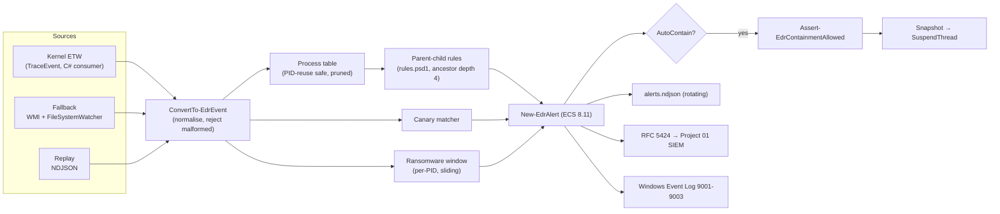

# Project 03 · EDR Canary and Process Tree: Architecture Defense

## 1. The SOC problem

Two of the most damaging intrusion patterns are visible in the **shape** of process activity long before any signature exists:

1. **Malicious documents.** A phishing attachment makes `WINWORD.EXE` start `cmd.exe` or `powershell.exe -enc …`. Word has almost no legitimate reason to start a shell, so this parent-child relationship has a far better signal-to-noise ratio than hash or domain IOCs, which change on every campaign.
2. **Ransomware.** Encryption is a mass file-modification burst by one process. Detecting it within seconds, and freezing that process, is the difference between losing ten files and losing a file server.

Commercial EDRs answer both with a kernel event stream and a process tree. This project builds that core in a form a SOC analyst can read, tune and test.

## 2. Pipeline

## 3. Design decisions

| Concern | Decision | Why |
|---|---|---|
| Telemetry source | Kernel ETW through `Microsoft.Diagnostics.Tracing.TraceEvent`, consumed by a small C# class that is compiled at runtime with `Add-Type` | PowerShell cannot keep up with a kernel event stream on its own. The C# consumer runs the ETW callback on its own thread and hands normalised dictionaries to PowerShell through a bounded `BlockingCollection`. Process, FileIO and DiskIO keywords are the same events commercial EDRs use, and Sysmon is not required. |
| Back-pressure | Bounded queue (`EDR_QUEUE_CAPACITY`) and a `Dropped` counter reported in the stop summary | During a ransomware burst the kernel can produce tens of thousands of events per second. Dropping and counting is honest and keeps memory bounded. Blocking the ETW callback would make the kernel drop events silently. |
| Supply chain | TraceEvent is downloaded from nuget.org and its SHA-256 is pinned before extraction | The DLL is loaded into an elevated process. An unpinned download would be a privileged code-execution path. |
| Degraded mode | Automatic fallback to WMI `Win32_ProcessStartTrace` plus a `FileSystemWatcher` on each canary | The sensor still detects maldoc trees and canary tampering on hosts where the NT Kernel Logger is already in use or TraceEvent is missing. |
| Process tree | Hashtable keyed by PID, with each entry storing its start time. A child is linked to a parent only if the parent started first, and walks stop on cycles and at depth 4 | Windows reuses PIDs quickly. Without a start-time check, a new process can inherit a dead process's children and produce false ancestry. Depth-limited ancestry catches indirect chains such as `winword → cmd → powershell`. |
| Detection content | `config/rules.psd1` holds the rules as data: parents, children, MITRE IDs, severity and command-line markers that raise severity one level | Detection engineers tune rules without editing code, and changes to rules are reviewable diffs. |
| Canary design | Names that sort first (`0_passwords.docx`, `00_finance_backup.xlsx`), hidden, with a baseline SHA-256 | Ransomware enumerates directories in order, so the decoy is among the first files hit. The hash proves tampering after the fact. Matching on the path tail handles kernel `\Device\HarddiskVolumeN\…` paths. |
| Behaviour heuristic | Per-PID sliding window of distinct paths, plus immediate alerts for known extensions and ransom notes. Each PID alerts once | Counting distinct files, not events, ignores databases rewriting one file. Alerting once per PID avoids an alert storm while encryption runs. |
| Containment | Thread suspension, not termination, after a metadata-only snapshot. Protected names and PIDs and the sensor itself are always refused. `ConfirmImpact=High` and `-WhatIf` are supported | Suspension stops encryption immediately while keeping memory for forensics. Killing `lsass` or `csrss` would bug-check the host, which is a self-inflicted outage. Auto-containment is off by default and opt-in. |
| Output contract | ECS 8.11 documents, the same schema as Project 01, plus syslog to Project 01 | Endpoint alerts join the SIEM's alert chains with no translation layer. Project 02 can then gate isolation on a human click. |

## 4. Why PowerShell

Windows SOC teams already run PowerShell everywhere, through Intune, SCCM, GPO and scheduled tasks. A signed module plus one NuGet DLL is far easier to get through change control than a new agent. The hot path, the ETW callback, is C#. The logic analysts tune (rules, tree walking, alert shape) stays in readable PowerShell with Pester tests.

## 5. Limits, stated plainly

- Kernel ETW requires administrator rights and one free NT Kernel Logger session.
- A user-mode sensor can be killed by an attacker with administrator rights. Production EDRs use protected-process light (PPL) and a kernel driver, which are out of scope here.
- Disk I/O events carry file names only when the FileIO rundown has populated the cache, so DiskIO is used as supporting evidence and FileIO drives detections.
