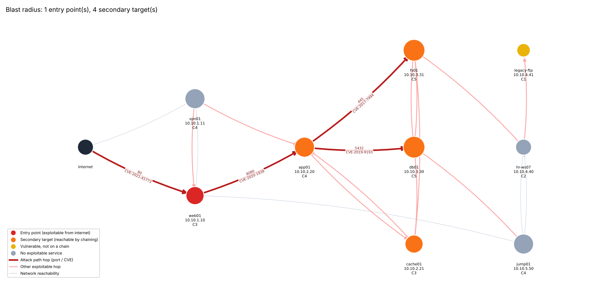

# 04 · Blast-Radius Vulnerability Scanner

> Part of the [Threat Response Engineering portfolio](../README.md). This folder is self-contained and can also be published as its own repository.

A vulnerability prioritiser that answers the question an analyst actually has on a Monday morning: **"If I can fix only three things today, which three remove the most risk?"**

It takes Nmap service scans and enriches every service with:

- CVEs from the **NIST NVD 2.0 API**, matched by CPE;
- the **FIRST EPSS** probability that each CVE is exploited in the next 30 days;
- the **CISA Known Exploited Vulnerabilities** catalogue.

It then builds a **NetworkX attack graph** from your network policy. That graph shows which secondary internal targets an attacker reaches after each foothold, and which hosts every attack path to the crown jewels must pass through. Output is **SARIF 2.1.0** (for GitHub code scanning or any SARIF viewer), a Markdown report, JSON, and a blast-radius image.

The design rationale is in [docs/ARCHITECTURE.md](docs/ARCHITECTURE.md).



## Quick start (no scanning, no API keys)

```bash
cd 04-blast-radius-vuln-scanner
python -m venv .venv && source .venv/bin/activate
pip install -r requirements-dev.txt

PYTHONPATH=src python -m vuln_scanner analyse examples/lab_scan.xml \
    --inventory examples/inventory.yml --feeds-dir examples/feeds \
    --sarif out/results.sarif --report out/report.md --graph out/blast_radius.png
```

```
11 findings across 9 hosts; 1 entry point(s); 3 attack path(s) to crown jewels.
    77.8  CVE-2021-42013   web01        10.10.1.10:80/tcp      EPSS 0.943  KEV  blast 4
    75.9  CVE-2020-1938    app01        10.10.2.20:8009/tcp    EPSS 0.944  KEV  blast 3
    ...
```

`examples/feeds/` holds an **illustrative** snapshot of NVD, EPSS and KEV data for the lab's fictional estate. The values are close to the real ones but are not authoritative. Use `snapshot` (below) to record real data. The rendered results are in [examples/output/](examples/output/). One of them is the blast radius from a single assumed-compromised host (`--focus 10.10.2.21`).

## Real use

```bash
cp .env.example .env                         # add NVD_API_KEY (free) for 10x the NVD rate limit
./scripts/scanner.sh -t 10.10.0.0/16 -p 1-10000 -i inventory.yml    # asks you to confirm authorisation
# or bring your own scan:
PYTHONPATH=src python -m vuln_scanner analyse scans/*.xml --inventory inventory.yml \
    --sarif results.sarif --report report.md --graph blast.png --fail-on 60
```

| Flag | Purpose |
|---|---|
| `--inventory` | Asset criticality (1 to 5), zones and the firewall policy between them. See [examples/inventory.yml](examples/inventory.yml). Without it, every host is criticality 2 and nothing is reachable from the internet |
| `--focus IP` | Draw the blast radius of one host, assumed compromised. Useful during an incident |
| `--fail-on N` | Exit with code 2 if any finding's priority is N or more. This gates a CI or CD pipeline |
| `--offline` | Use only the local SQLite cache (the last good copy of each feed) |
| `--feeds-dir` | Use snapshot files (air-gapped networks, reproducible runs) |
| `--keyword-fallback` | Query NVD by banner text when Nmap found no CPE. These findings are marked low precision |
| `snapshot … --out DIR` | Record the live NVD, EPSS and KEV responses for these scans into a `--feeds-dir` directory |

Docker: `docker build -t vuln-scanner . && docker run --rm -v "$PWD/out:/out" vuln-scanner` runs the lab example as a non-root user.

## How priority is computed

```
likelihood = max(EPSS, 0.7 if in CISA KEV)
priority   = 100 × √likelihood × CVSS/10 × (0.3·criticality/5 + 0.25·exposure + 0.25·blast radius + 0.2·chokepoint)
```

In the lab, the CVSS **10.0** Redis bug ranks **6th**. It sits behind an internet-facing CVSS 9.8 that is in KEV and opens a path to four internal hosts, including both crown jewels. The vsftpd backdoor (CVSS 9.8, EPSS 0.88) on an isolated, expendable host ranks 8th. Both are correct calls that sorting by CVSS gets wrong. The report includes a "Why not just sort by CVSS?" section that explains the difference on your own data.

## GitHub code scanning

```yaml
- run: PYTHONPATH=src python -m vuln_scanner analyse scans/*.xml --inventory inventory.yml --sarif results.sarif
- uses: github/codeql-action/upload-sarif@v3
  with: { sarif_file: results.sarif, category: blast-radius }
```

Each result points at the exact line of the Nmap XML that proves the service is listening. `rank` carries the priority, and `security-severity` carries CVSS, which GitHub uses for its severity labels.

## Tests

```bash
pytest --cov          # 79 tests, 98% coverage, gate 85%
```

The suite covers:

- XXE rejection.
- Nmap line mapping.
- CPE conversion.
- Policy evaluation.
- Feed caching, retry with `Retry-After`, the stale-cache fallback and offline mode.
- NVD pagination.
- EPSS batching.
- Blast radius on cyclic graphs.
- The most-likely-path maths.
- Bounds and monotonicity of the priority function.
- SARIF structural validation.
- PNG and SVG rendering.
- The CLI exit codes.
- A snapshot-then-replay round trip.
- `scanner.sh`, run against a stub `nmap`, including its authorisation gate and argument injection attempts.

## Safety

Only scan systems you own or have written permission to test. `scanner.sh` refuses to run until you confirm authorisation, either by typing a phrase or by setting `SCAN_AUTHORIZED=yes`. It validates the target, ports and timing against strict patterns before anything reaches `nmap`. The tool only reads public vulnerability metadata. It never exploits anything.

## Project layout

```text
04-blast-radius-vuln-scanner/
├── src/vuln_scanner/
│   ├── cli.py             `analyse` and `snapshot` subcommands
│   ├── nmap_parser.py     safe Nmap XML parsing
│   ├── feeds/             NVD, EPSS and CISA KEV clients, HTTP cache, local feed files
│   ├── inventory.py       asset inventory and network policy
│   ├── graph.py           reachability, exploit graph, blast radius, attack paths
│   ├── analysis.py        scoring and ranking
│   ├── report.py, sarif.py, render.py   Markdown/JSON, SARIF 2.1.0 and the graph image
│   └── config.py
├── scripts/scanner.sh     Nmap front end (asks for authorisation first)
├── examples/              lab scan, inventory, recorded feeds and sample outputs
├── tests/                 pytest suite
├── docs/ARCHITECTURE.md
├── Dockerfile
└── .env.example
```

## Development

```bash
python -m venv .venv && source .venv/bin/activate   # Windows: .venv\Scripts\activate
pip install -r requirements-dev.txt ruff
ruff check .            # lint, using this folder's ruff.toml (includes security rules)
pytest --cov            # tests with the 85% coverage gate
```

Every module, class and public function has a docstring explaining what it does,
its arguments and the errors it raises. Start reading at `docs/ARCHITECTURE.md`,
then the entry point named in the layout above.

CI (`.github/workflows/ci.yml`) runs lint and tests on Python 3.10 and 3.13,
`pip-audit` on the runtime dependencies, and a non-root Docker build.

## Licence

MIT. See [LICENSE](LICENSE).
