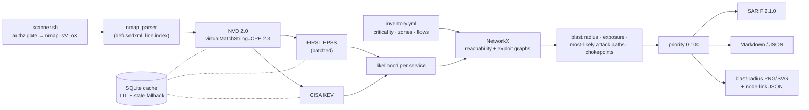

# Project 04 · Blast-Radius Vulnerability Scanner: Architecture Defense

## 1. The SOC problem

A mid-size estate produces thousands of CVE findings. Teams that patch in CVSS order spend their effort on the wrong things, for three reasons:

1. **CVSS measures severity, not likelihood.** Most published CVEs are never exploited. FIRST's EPSS model estimates the 30-day exploitation probability from real-world signals. CISA KEV lists the CVEs that *are* being exploited.
2. **CVSS ignores where the asset sits.** The same Tomcat bug on an internet-reachable pivot host and on an isolated lab box are not the same risk.
3. **CVSS ignores what an attacker gains next.** The finding that matters most is often the one that opens the path to the database, not the one with the highest score.

This tool ranks findings by **likelihood × impact × network context**. It also draws what an attacker reaches from each foothold, so analysts can justify the order to change-advisory boards and asset owners.

## 2. Pipeline

## 3. Design decisions

| Concern | Decision | Why |
|---|---|---|
| Likelihood | EPSS probability, with a floor (default 0.7) for CVEs in CISA KEV | EPSS is the best public estimate of exploitation. KEV is ground truth that exploitation is already happening, so it sets a floor rather than adding a bonus that could push the value past 1. |
| Long-tail EPSS | `√likelihood` in the score | Most EPSS values sit below 0.01. A linear factor would flatten every non-KEV finding to roughly zero. The square root spreads them out without changing their order. |
| Network context | Two directed graphs. **Reachability**: policy lets A reach an open port on B. **Exploit**: the subset of those edges where that port runs a service with likelihood at or above the threshold | Separating "can talk to" from "can take over" is the core of attack-graph analysis. Policy comes from a reviewable YAML file of zones and flows, because the scanner alone cannot see firewall rules. |
| Blast radius | Exploit-graph BFS from a host, up to `max_hops`. Score = Σ criticality × 0.5^(hop−1), relative to the worst host in the scan | This gives the "secondary internal targets" if the host falls. The hop decay reflects that each extra pivot is extra attacker work and extra chances for detection. |
| Attack paths | Dijkstra from `internet` to every crown jewel (criticality 4 or more) with edge weight −log(likelihood) | The minimum sum of −log p is the maximum product of p, so this finds the *most likely* chain rather than the shortest one. Each path is reported with its probability and the CVE used at each hop. |
| Chokepoints | Share of those paths that pass through a host | Fixing a chokepoint breaks many chains at once. In the lab, that is why the front-door Apache RCE ranks above the CVSS-10 Redis bug. |
| Exposure | internet (1.0), chained (0.5: reachable from a host an internet attacker can take), internal (0.25) | Exposure distinguishes the front door from the back office without needing a separate external scan. |
| Untrusted input | Nmap XML parsed with `defusedxml`. `scanner.sh` validates the target, port spec and timing against allow-list regexes, and passes arguments as an array | Scan files can come from anywhere, so XXE and billion-laughs payloads are refused. Alert-style injection such as `10.0.0.1;id` never reaches a shell, and a test proves it. |
| API etiquette | NVD calls spaced 6.5 s apart (0.65 s with a key). Retries on 403, 429 and 5xx with `Retry-After`. EPSS lookups batched 100 per request. Responses cached for 24 h in SQLite, with the stale copy used if a feed is down | NVD returns 403 when you exceed its rate limit. The cache makes repeat runs fast, keeps the tool polite to public services, and lets it keep working through a feed outage. |
| Degradation | Feed errors are collected rather than raised. If EPSS is down, KEV still drives the ranking. SARIF records `executionSuccessful: false` with the reasons | A partial answer that says it is partial beats a stack trace at 9 a.m. |
| SARIF | One rule per CVE and one result per (host, port, CVE). The physical location is the exact Nmap XML line. `rank` holds the priority, `security-severity` holds CVSS, and a stable `partialFingerprints` value is included | Findings appear in GitHub code scanning with severity labels, and repeat scans deduplicate instead of piling up. A built-in structural validator runs before the file is written. |
| Reproducibility | `snapshot` records live feed responses, and `--feeds-dir` replays them | Audit evidence ("this is what we knew on the 26th"), air-gapped networks, and deterministic tests. |
| CI gate | `--fail-on N` exits with code 2 | A pipeline can block a deployment that would add a high-priority, reachable vulnerability. |

## 4. Why NetworkX and matplotlib

NetworkX provides tested implementations of BFS, Dijkstra and the node-link export, so the analysis stays at the level of security questions. Estates in the low thousands of hosts fit comfortably in memory. The node-link JSON export loads into Neo4j or D3 for bigger interactive views. matplotlib with the Agg backend renders headless in CI and containers. The layout places columns by network distance from the internet, so the picture reads left to right in the same direction as the attack.

## 5. Limits, stated plainly

- **CPE matching is only as good as Nmap's fingerprint.** Backported distro patches (for example `7.2p2 Ubuntu 4ubuntu2.10`) can produce false positives. Findings matched by banner text are flagged `precision: low`.
- **CVE-to-port attribution is per product.** In the lab, the Ghostcat CVE appears on both Tomcat ports, although only the AJP port (8009) is the real vector.
- **The attack graph models network reachability and remote exploits only.** Credential theft and lateral movement through identity systems (Kerberos, cloud IAM) are out of scope. In real estates these widen the blast radius, so treat the result as a lower bound.
