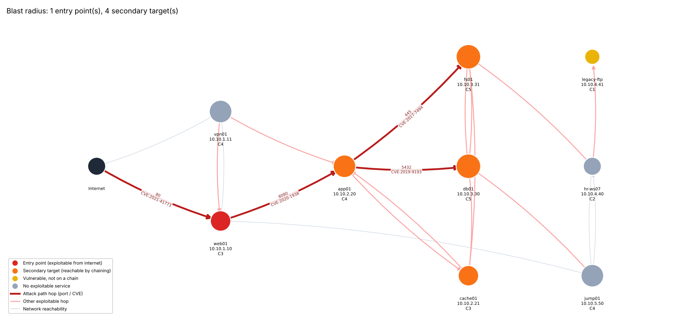

# Blast-radius vulnerability report

Scanned **9 hosts / 11 services**, found **11 CVE findings** (6 in CISA KEV). **1 entry point(s)** are exploitable from the internet.

## Fix first

| # | Priority | Asset | Service | CVE | CVSS | EPSS | KEV | Exposure | Blast radius |
|---|---|---|---|---|---|---|---|---|---|
| 1 | **77.8** | web01 (10.10.1.10) | 80/tcp Apache httpd 2.4.49 | [CVE-2021-42013](https://nvd.nist.gov/vuln/detail/CVE-2021-42013) | 9.8 | 0.943 | yes | internet | 4 host(s) |
| 2 | **75.9** | app01 (10.10.2.20) | 8009/tcp Apache Jserv | [CVE-2020-1938](https://nvd.nist.gov/vuln/detail/CVE-2020-1938) | 9.8 | 0.944 | yes | chained | 3 host(s) |
| 3 | **75.9** | app01 (10.10.2.20) | 8080/tcp Apache Tomcat 9.0.30 | [CVE-2020-1938](https://nvd.nist.gov/vuln/detail/CVE-2020-1938) | 9.8 | 0.944 | yes | chained | 3 host(s) |
| 4 | **59.6** | web01 (10.10.1.10) | 80/tcp Apache httpd 2.4.49 | [CVE-2021-41773](https://nvd.nist.gov/vuln/detail/CVE-2021-41773) | 7.5 | 0.944 | yes | internet | 4 host(s) |
| 5 | **55.2** | fs01 (10.10.3.31) | 445/tcp Samba smbd 4.5.9 | [CVE-2017-7494](https://nvd.nist.gov/vuln/detail/CVE-2017-7494) | 9.8 | 0.941 | yes | chained | 1 host(s) |
| 6 | **53.9** | cache01 (10.10.2.21) | 6379/tcp Redis key-value store 5.0.7 | [CVE-2022-0543](https://nvd.nist.gov/vuln/detail/CVE-2022-0543) | 10.0 | 0.943 | yes | chained | 3 host(s) |
| 7 | **32.9** | db01 (10.10.3.30) | 5432/tcp PostgreSQL DB 9.6.0 | [CVE-2019-9193](https://nvd.nist.gov/vuln/detail/CVE-2019-9193) | 7.2 | 0.620 |  | chained | 1 host(s) |
| 8 | **11.3** | legacy-ftp (10.10.4.41) | 21/tcp vsftpd 2.3.4 | [CVE-2011-2523](https://nvd.nist.gov/vuln/detail/CVE-2011-2523) | 9.8 | 0.880 |  | internal | 0 host(s) |
| 9 | **8.5** | web01 (10.10.1.10) | 22/tcp OpenSSH 7.2p2 Ubuntu 4ubuntu2.10 | [CVE-2016-10009](https://nvd.nist.gov/vuln/detail/CVE-2016-10009) | 7.3 | 0.034 |  | internal | 4 host(s) |
| 10 | **5.6** | db01 (10.10.3.30) | 5432/tcp PostgreSQL DB 9.6.0 | [CVE-2018-1058](https://nvd.nist.gov/vuln/detail/CVE-2018-1058) | 8.8 | 0.012 |  | chained | 1 host(s) |
| 11 | **5.4** | web01 (10.10.1.10) | 22/tcp OpenSSH 7.2p2 Ubuntu 4ubuntu2.10 | [CVE-2016-6210](https://nvd.nist.gov/vuln/detail/CVE-2016-6210) | 5.9 | 0.021 |  | internal | 4 host(s) |

## Why not just sort by CVSS?

CVSS alone would put **CVE-2022-0543** on cache01 first (CVSS 10.0, EPSS 0.943, chained, blast radius 3). This report puts **CVE-2021-42013** on web01 first (CVSS 9.8, EPSS 0.943, in CISA KEV, internet, blast radius 4).

## Attack paths to crown jewels

- **app01** (path likelihood 0.89): Internet → web01 → app01
    - Internet → web01 on 80 via CVE-2021-41773
    - web01 → app01 on 8080 via CVE-2020-1938
- **fs01** (path likelihood 0.84): Internet → web01 → app01 → fs01
    - Internet → web01 on 80 via CVE-2021-41773
    - web01 → app01 on 8080 via CVE-2020-1938
    - app01 → fs01 on 445 via CVE-2017-7494
- **db01** (path likelihood 0.55): Internet → web01 → app01 → db01
    - Internet → web01 on 80 via CVE-2021-41773
    - web01 → app01 on 8080 via CVE-2020-1938
    - app01 → db01 on 5432 via CVE-2019-9193

## Blast radius by entry point

### web01 (10.10.1.10): score 10.50, 4 secondary target(s)

- hop 1: app01 (10.10.2.20), criticality 4, via 8080 / CVE-2020-1938
- hop 2: db01 (10.10.3.30), criticality 5, via 5432 / CVE-2019-9193
- hop 2: fs01 (10.10.3.31), criticality 5, via 445 / CVE-2017-7494
- hop 2: cache01 (10.10.2.21), criticality 3, via 6379 / CVE-2022-0543

## Method

Priority = 100 × √likelihood × CVSS/10 × (0.3·criticality/5 + 0.25·exposure + 0.25·blast radius + 0.2·chokepoint). Likelihood is the FIRST EPSS probability, floored for CISA KEV entries. Exposure is 1.0 for internet-facing, 0.5 when reachable from a host an internet attacker can take, 0.25 otherwise. Blast radius is the criticality reachable by chaining exploitable services from the host (halved per hop), relative to the worst host in this scan. Chokepoint is the share of attack paths that pass through the host.
