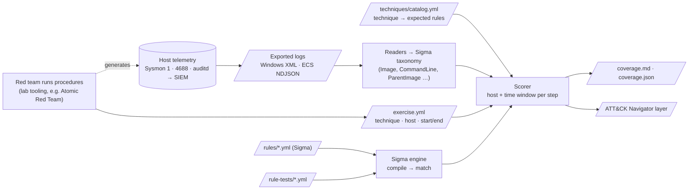

# Project 05 · Sigma-Validated ATT&CK Detection Coverage: Architecture Defense

## 1. The SOC problem

"We'd catch that" is usually an assumption. Incident reviews keep finding the same two failures:

- **Telemetry gaps.** The endpoint was never onboarded, Sysmon was not deployed, 4688 had no command line, or the forwarder dropped the channel. No rule can fire on events that never arrive.
- **Detection gaps.** The events are in the SIEM, but the rule is missing, too narrow (`dir` but not `dir /s`), or scoped to the wrong platform.

Purple-team exercises exist to find both. The usual output is a spreadsheet of ticks that cannot be reproduced. This project makes the result **measured and repeatable**. The same rules, logs and exercise timeline always produce the same score, and each gap is labelled with the team that owns the fix.

## 2. Flow

## 3. Design decisions

| Concern | Decision | Why |
|---|---|---|
| Rule format | Standard Sigma YAML, validated on load: UUID ids, status and level enums, logsource, `attack.*` tags, and conditions | Sigma is the vendor-neutral detection language. Rules written here also convert with pySigma to Splunk, Elastic or Sentinel queries, so the coverage score measures content the SOC can deploy. |
| Evaluation | A built-in engine compiles each selection into a closure once. It supports the common modifiers (contains, startswith, endswith, all, re, windash, cidr, exists, cased, numeric comparisons, fieldref) and the full condition grammar | pySigma converts rules into backend queries but cannot evaluate them in memory. A compiled matcher scores a whole exercise export in milliseconds, with no SIEM involved. |
| Unsupported features | Encoding modifiers and correlation rules raise an error at load time | A rule that loads but can never match would silently lower coverage. Failing loudly is the honest behaviour. |
| Normalisation | Sysmon EID 1 and Security 4688 (with its different field names and hex PIDs) both map to Sigma's process_creation taxonomy, as do ECS process-start documents | One rule set covers all three sources, which is how SigmaHQ rules are written. |
| Attributing events to steps | Host plus time window (with configurable skew), not command-line markers | Real exercise procedures such as `whoami /all` carry no markers. Host and time are what the exercise log records, and they are how an analyst would check by hand. |
| Outcome taxonomy | `DETECTED`, `DETECTION_GAP`, `TELEMETRY_GAP` and `NO_CONTENT`, decided per step. A technique takes its worst step | Each gap goes to a different owner. Taking the worst step stops a technique counting as covered when one exercised host is blind, because that is the host an attacker would use. |
| Untrusted input | defusedxml for XML exports and `yaml.safe_load` for all YAML | Log exports and rule packs come from other machines and other teams. |
| Detection as code | Positive and negative cases for every rule (`rule-tests/`), `--require-all` in CI, and a lint step that checks catalogue tags against rule tags | Rule changes are reviewed and tested like code. A broadened rule that starts matching benign events fails CI. |
| Reporting | Markdown for people, JSON for pipelines, and an ATT&CK Navigator layer for leadership. `--min-coverage` exits with code 2 | The same run serves the analyst fixing gaps, the dashboard, and the CI gate that stops coverage regressing. |

## 4. Limits, stated plainly

- Only the process_creation category is normalised. Network, registry and file events would need more readers.
- Time-window attribution can credit a detection to a step when unrelated activity on the same host matches the same rule inside the window. Keep exercise windows tight, and read the evidence lines in the report.
- The score is only as good as the exercise. Untested techniques are not shown as covered or uncovered. They are simply absent from the report.
