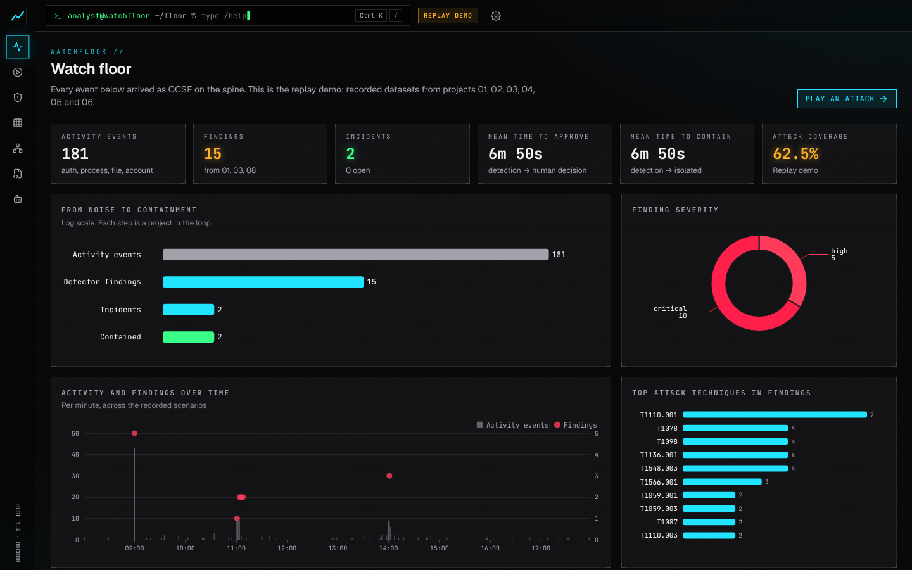
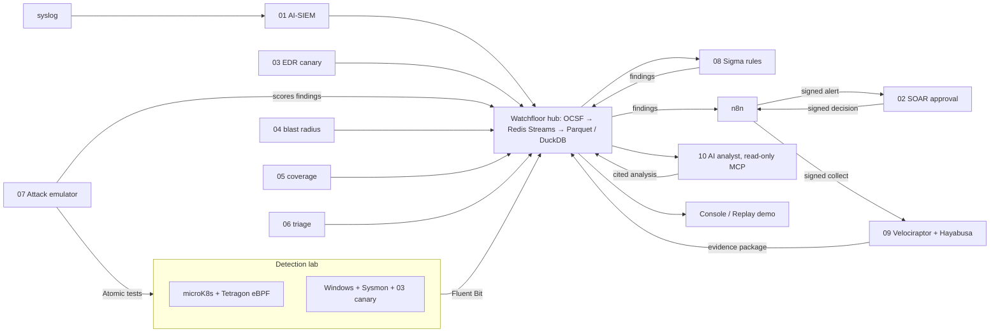

# Threat Response Engineering Portfolio

Ten security operations projects and the platform that joins them into one loop: **emulate → detect → correlate → triage → contain → collect evidence → explain → measure**.

Each numbered project lives in its own folder and stays self-contained: its own source, tests, documentation, dependencies, `.env.example`, licence, lint config and CI workflow. You can read and run any one of them alone, or publish a single folder as its own repository. **Watchfloor** is the shared spine and console that connects them, and `deploy/` runs the whole thing with one `docker compose`.

**Live replay demo:** the Watchfloor console runs on GitHub Pages with no backend (see [Publishing](#publishing-to-github)).



## Projects

| # | Project | What it does | Stack | Tests |
|---|---|---|---|---|
| 01 | [Real-time AI-SIEM](01-realtime-ai-siem/) | UDP syslog in real time, ECS 8.11 mapping, streaming brute-force, spraying and privilege detections, Claude summaries of each alert chain | Python, asyncio, Anthropic SDK | 88 |
| 02 | [Human-in-the-loop SOAR bot](02-hitl-soar-bot/) | Alerts become incidents with an approval card in Slack or Discord; a host is isolated only after a signed analyst approval. Signed decision webhook out. MTTA and MTTR | Python, Flask, SQLite, Docker | 79 |
| 03 | [EDR canary and process tree](03-edr-canary-process-tree/) | Live process tree from kernel ETW, Office-spawns-shell detection, canary files as ransomware tripwires, guarded containment | PowerShell, C#, TraceEvent, Pester | 75 |
| 04 | [Blast-radius vulnerability scanner](04-blast-radius-vuln-scanner/) | Nmap, NVD, EPSS and CISA KEV into an attack graph; fixes ranked by blast radius and chokepoints; SARIF | Python, NetworkX | 79 |
| 05 | [Sigma ATT&CK coverage](05-sigma-attack-coverage/) | Scores purple-team log exports with a built-in Sigma engine; detection and telemetry coverage; Navigator layer | Python, Sigma | 68 |
| 06 | [Alert clustering and FP reducer](06-alert-clustering-fp-reducer/) | TF-IDF and DBSCAN clustering, CMDB enrichment, structural false-positive suppression, guarded Claude triage | Python, scikit-learn, SQLite | 97 |
| 07 | [Attack emulator](07-attack-emulator/) | Runs Atomic Red Team tests on the lab (kubectl, WinRM, SSH) or replays recorded telemetry, then scores each technique against the platform: detected, prevented, telemetry only, missed, error | Python, Atomic Red Team | 96 |
| 08 | [Detection rules](08-detection-rules/) | Sigma rules compiled through a custom OCSF pipeline and DuckDB backend, tested against samples, run on a watermark over the lake | Python, pySigma, DuckDB | 37 |
| 09 | [Evidence timeline](09-evidence-timeline/) | After an approved containment: Velociraptor runs Hayabusa and read-only triage on the host, merged with platform telemetry into one hashed timeline | Python, Velociraptor gRPC, Hayabusa | 34 |
| 10 | [AI analyst (MCP)](10-ai-analyst-mcp/) | Eight read-only MCP tools over the lake (DuckDB) and CMDB (SQLite); investigates every incident with Claude, a local model or offline rules, with checked citations and prompt-injection evals | Python, MCP, Anthropic SDK | 80 |

| Platform | What it is | Tests |
|---|---|---|
| [Watchfloor](watchfloor/) | OCSF 1.4.0 spine on Redis Streams, Parquet lake queried by DuckDB, FastAPI hub, React console with Replay Mode | 70 backend, 6 unit, 7 browser |
| [n8n playbooks](automation/) | Alert intake (findings → signed approval in 02) and decision follow-up (02's signed decision → evidence collection in 09 → channel) | 23 |
| [Detection lab](lab/) | Vagrant and Ansible: microK8s with Tetragon eBPF, a Windows endpoint with Sysmon, 03's canary and Velociraptor, all shipping to the hub | syntax-checked |
| [Deploy](deploy/) | One compose file with profiles: core, automation, detect, dfir, ai, batch | |
| [aegis-ui](packages/aegis-ui/) | The design system shared by the Watchfloor console and Driftwatch | 10 |
| [Driftwatch](https://github.com/blackdalc7/DriftWatch-Project) | Continuous security validation for a small lab: signed, benign agent tests scored against Elastic, plus configuration drift detection. Self-contained with its own CI; published as its own repository | 70 backend |

## How they connect



Containment has exactly one door: 02, after a signed human click. The console's "request isolation", the n8n playbooks and the AI analyst can only ask 02 to post an approval card.

## Folder structure

```text
GITHUB_PROJECT/
├── 01-…06-…/                     the original projects (unchanged in purpose; 02 gained a signed decision webhook)
├── 07-attack-emulator/           each numbered project contains:
├── 08-detection-rules/           │  README.md      overview, quick start, safety, layout, tests, limits
├── 09-evidence-timeline/         │  src/           implementation
├── 10-ai-analyst-mcp/            │  tests/         offline test suite with a coverage gate
│                                 │  .github/       standalone CI and Dependabot
│                                 │  .env.example, Dockerfile (where it runs as a service), LICENSE
├── watchfloor/
│   ├── backend/                  hub, spine, lake, mappers, CLI (src/, scripts/)
│   ├── frontend/                 React console
│   ├── tests/                    backend/ (pytest) and e2e/ (Playwright)
│   └── datasets/scenarios/       recorded OCSF scenarios with provenance
├── automation/n8n/               Code-node sources, workflow generator, exports, tests
├── lab/                          Vagrantfile and Ansible roles
├── deploy/                       docker-compose.yml, .env.example, Dockerfiles for the hub and Velociraptor
├── packages/aegis-ui/            shared design system
├── docs/ARCHITECTURE_DEFENSE.md  design index across everything
├── .github/workflows/            portfolio CI and the Pages deploy
└── Makefile, SECURITY.md, CONTRIBUTING.md, LICENSE
```

## Quick start

```bash
make install          # every Python project's dev dependencies
make test             # every Python suite, the n8n playbook tests, and Pester if pwsh is installed
make lint             # ruff with security rules everywhere
make purple-loop      # 07 → hub → lake → 08 rules → findings → 07 scoring, in one process, no Docker
make evals            # 10's triage and prompt-injection evals
make demo frontend    # export the replay data and build the console
make test P=08-detection-rules
```

Run the whole platform:

```bash
cd deploy && cp .env.example .env     # fill in the secrets it lists
docker compose up -d --build                                   # hub, console, Redis, ingest, 01, 02
docker compose --profile detect --profile automation --profile dfir --profile ai up -d
```

Nothing needs a credential to run the tests or the demo. The AI parts (01, 06, 10) use Claude when credentials are present and fall back to deterministic offline logic when they are not.

## Publishing to GitHub

- **One portfolio repository:** push this folder. `.github/workflows/ci.yml` tests every project, the purple loop, the playbooks, the console and the lab playbooks; `pages.yml` publishes the replay demo (Settings → Pages → Source: GitHub Actions).
- **One repository per project:** push any numbered folder on its own; its own `.github/workflows/ci.yml` takes over.

## Engineering standards

- **No placeholders.** Every code path is implemented and tested, with an 85% coverage gate per Python project (actual 89–99%). Where something could not be run in the build environment (the lab VMs, a live Velociraptor server, a real n8n import, a Claude API call), the project's README says so in its Limits section.
- **Secure by design.** Secrets only from `.env` (git-ignored); every signed hop has its own secret; untrusted input is parsed defensively; SQL and VQL are always parameterised; LLM tools are read-only and their output is checked. Containers run as non-root with read-only filesystems.
- **CI.** ruff and pytest on Python 3.10 and 3.13, Sigma rule sample tests, a true-threat recall gate (06), an analyst eval gate (10), the end-to-end purple loop, n8n export freshness and signature tests, console unit, type and build checks, Ansible syntax, Pester and PSScriptAnalyzer, Docker builds, gitleaks and pip-audit.
- **Defensive only.** Emulation runs only in an isolated lab behind CIDR and context allowlists and an explicit opt-in. No project contains exploit code or payloads, and every active response needs a human in the loop.

See [SECURITY.md](SECURITY.md), [CONTRIBUTING.md](CONTRIBUTING.md) and [docs/ARCHITECTURE_DEFENSE.md](docs/ARCHITECTURE_DEFENSE.md).

## Licence

MIT. See [LICENSE](LICENSE).
