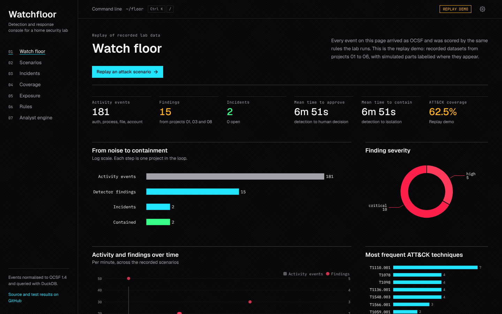
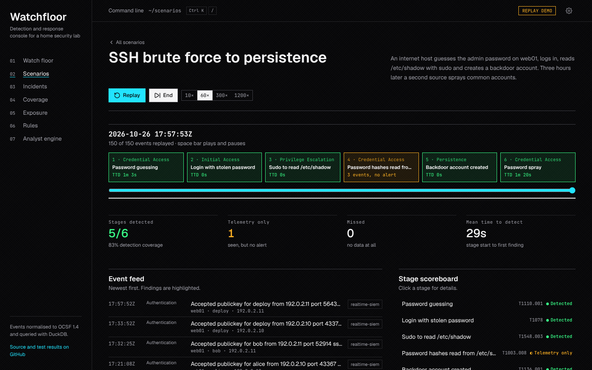
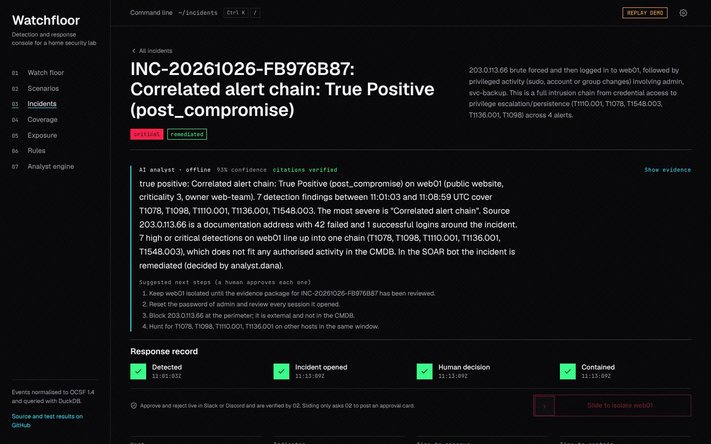
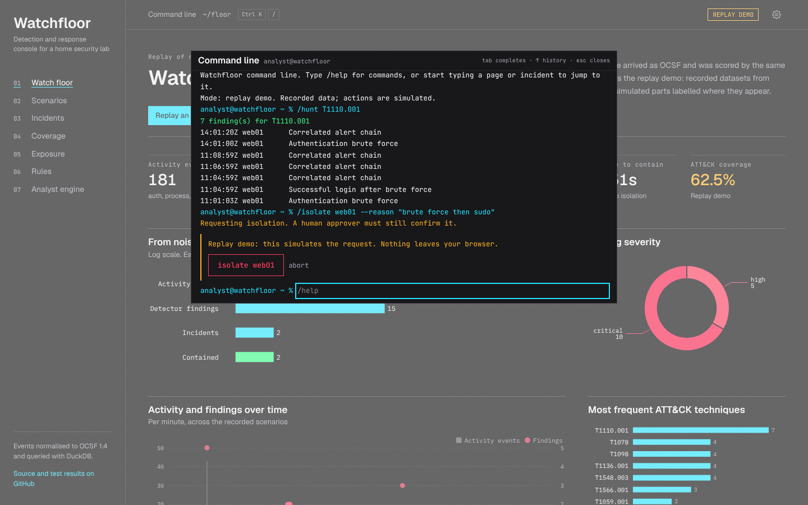
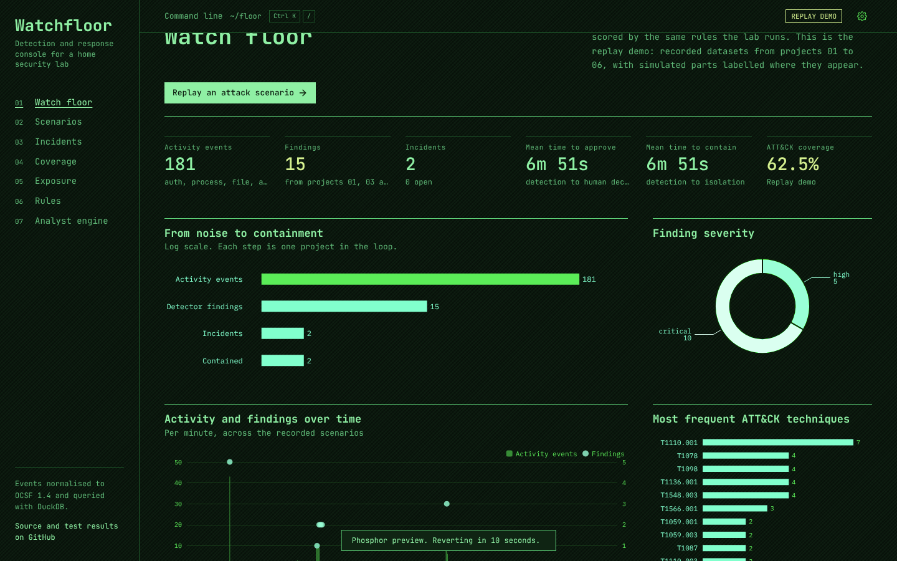
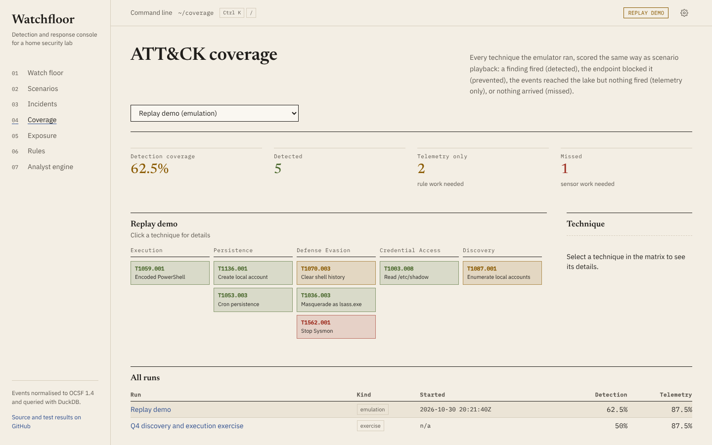
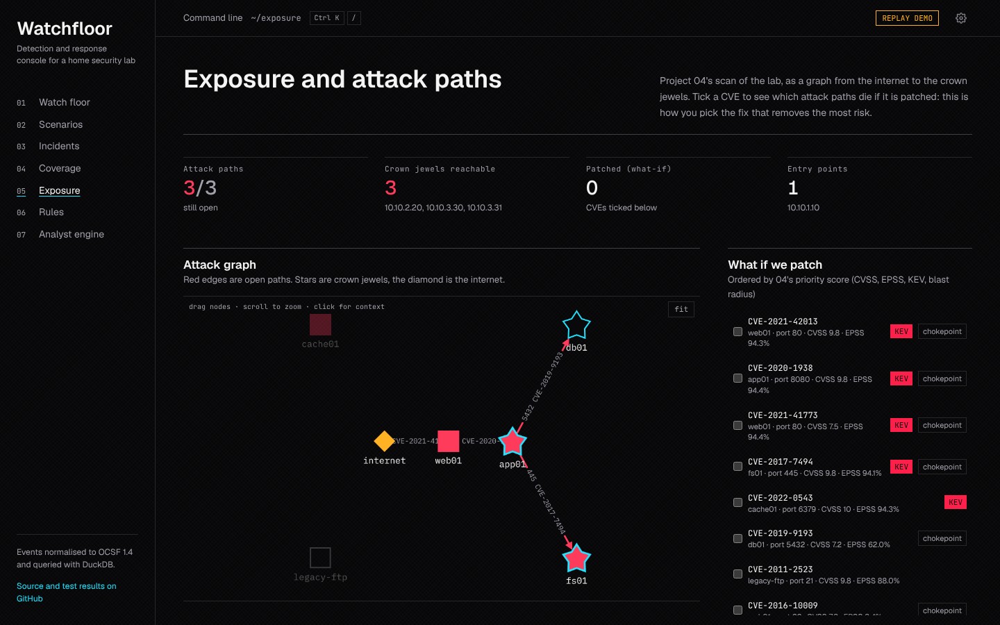
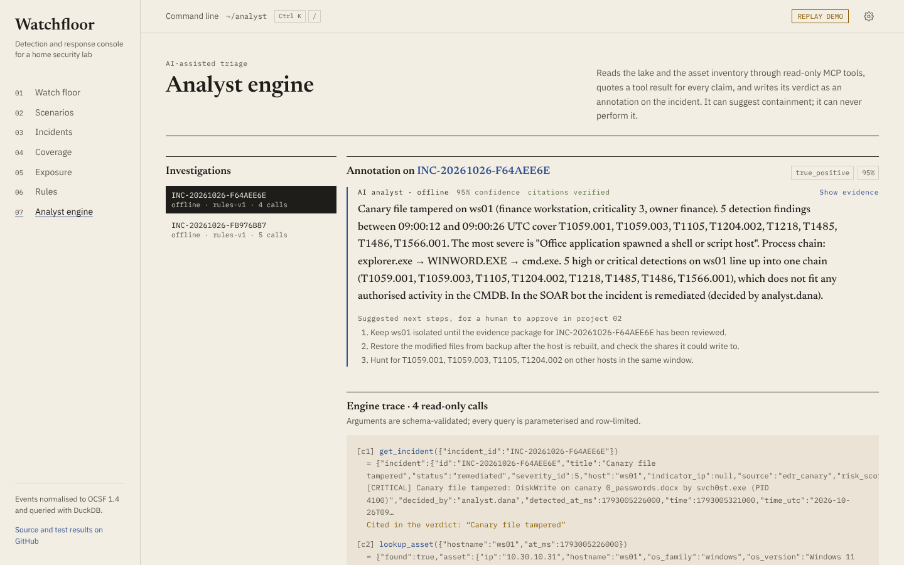

# Watchfloor: the hub that ties the portfolio together

Watchfloor is the shared data spine, API and dashboard for projects 01 to 10. Every tool keeps doing its own
job and its own tests; Watchfloor converts what each one emits into **OCSF 1.4.0**, moves it over **Redis
Streams**, stores it as **Parquet** queried by **DuckDB**, and shows the whole loop (emulate, detect, triage,
contain, collect evidence, explain, score) in one React dashboard.



| | |
|---|---|
|  |  |
|  |  |
|  |  |
|  | |

## What it does

* **One schema.** Seven OCSF classes (Authentication 3002, Account Change 3001, Process Activity 1007, File
  System Activity 1001, Network Activity 4001, Detection Finding 2004, Incident Finding 2005), each with a JSON
  Schema in [`backend/src/watchfloor/schemas`](backend/src/watchfloor/schemas). Projects keep their native formats; mappers at the
  edge convert 01 (ECS), 02 incidents, 03 EDR records and alerts, 06 meta-alerts, Tetragon eBPF events and
  Windows Sysmon/Security events.
* **A durable spine.** Producers `XADD` to `wf:events`; invalid events go to the `wf:dead` dead-letter stream with
  the reason. The `lake-writer` consumer group acknowledges a message only after its Parquet file is renamed into
  place, so a crash replays rather than loses data.
* **A cheap lake.** Hive-partitioned Parquet (`class_uid=/dt=/hr=`), zstd-compressed, compacted per closed hour.
  DuckDB reads it in-process with fixed, parameterised SQL. No database server to run.
* **A hub API** (FastAPI) for events, findings, incidents, process trees, scenario scoring, coverage, exposure
  what-if, rules, evidence and AI transcripts, plus a live SSE stream and a token-protected ingest endpoint for
  Fluent Bit and the detection runner.
* **A console** (React 19, TypeScript, Tailwind 4, motion, ECharts, Cytoscape) built on the
  [`@portfolio/aegis-ui`](../packages/aegis-ui) design system, whose rules are written down in
  [`DESIGN.md`](../packages/aegis-ui/DESIGN.md). Seven pages: watch floor, scenario playback, incidents,
  ATT&CK coverage, exposure graph, detection rules and the analyst engine.
* **Replay mode.** `export-demo` runs the real query code over the recorded datasets and writes static JSON, so the
  same UI runs on GitHub Pages with no backend. The badge in the header says LIVE or REPLAY DEMO.

## How 07 to 10 plug in

| Project | Writes to the hub | Shown on |
|---|---|---|
| [07 attack emulator](../07-attack-emulator/README.md) | replays or runs Atomic tests, then reads `/api/findings` and `/api/events` to score them; results are `emulation-run` JSON in `WF_COVERAGE_DIR` | Coverage (prevented, detected, telemetry only, missed, error, skipped) |
| [08 detection rules](../08-detection-rules/README.md) | Sigma rules compiled to DuckDB SQL run over the lake and post Detection Findings to `/api/ingest/ocsf`; `rules_index.json` via `WF_RULES_INDEX` | Rules, findings everywhere |
| Tetragon and Sysmon ([lab](../lab/README.md)) | Fluent Bit posts to `/api/ingest/tetragon` and `/api/ingest/winlog` | process trees, events |
| [n8n playbooks](../automation/n8n/README.md) | poll `/api/findings`, open signed approvals in 02, start evidence collection after an approval | incidents |
| [09 evidence timeline](../09-evidence-timeline/README.md) | packages in `WF_EVIDENCE_DIR` (reads `/api/events` for the host and window) | the incident page |
| [10 AI analyst](../10-ai-analyst-mcp/README.md) | transcripts in `WF_ANALYST_DIR` (reads the lake directly, read-only) | Analyst, ghost annotations on incidents |

## The console

* **Two themes.** The default is the dark obsidian console (zinc-950, neon used only to encode meaning, Geist and
  JetBrains Mono). Light mode in Settings switches to a cream paper theme with Newsreader headings. Both share the
  same layout: sections divided by rules rather than boxed cards, and a page header that states where each page's
  data came from. The full rules are in [`DESIGN.md`](../packages/aegis-ui/DESIGN.md).
* **Keyboard first.** Ctrl K (or `/`) opens a command line: `/cd coverage`, `/ls incidents`,
  `/play maldoc-to-ransomware`, `/incident INC-2026`, `/hunt T1110.001`, `/workload`, `/isolate web01 --reason "..."`,
  with Tab completion and history. Typing plain text jumps to pages, scenarios and incidents. The numbered page
  index in the left column and number keys 1 to 7 cover mouse and keyboard users.
* **High friction where it matters.** "Request isolation" (on an incident, or `/isolate`) is a hold-to-confirm
  button. It does not isolate anything: it asks 02 to post an approval card, so a second human still has to click
  Approve in Slack or Discord. The hub only enables it with `WF_ACTIONS_ENABLED`, a hub token and 02's shared
  secret; in the replay demo it is simulated and says so.
* **AI as an engine, not a chatbot.** Analyst verdicts appear as marginal notes on the incident, with a
  "Show evidence" sheet listing the quoted tool results; the Analyst page shows the tool-call trace like `strace`.
* **Opt-in drills.** The Konami code (↑ ↑ ↓ ↓ ← → ← → B A) shows a ten-second green-screen preview, and
  Settings, "Tabletop drill", shows what a defaced console looks like. Both are cosmetic and reversible; neither
  touches data or actions.

## The scenario game

Open **Scenarios** and press play. A recorded attack replays on a virtual clock (10x to 1200x). Each kill-chain
stage lights up green when a finding with a matching ATT&CK technique arrives within 15 minutes, amber when the
platform saw the activity but no rule fired, and red when nothing arrived. The scoreboard shows detection
coverage and mean time to detect, and the gap panel explains what would close each gap. The browser scoring in
[`frontend/src/lib/logic.ts`](frontend/src/lib/logic.ts) mirrors [`scenarios.py`](backend/src/watchfloor/scenarios.py), and both are
tested to agree.

Two scenarios ship in [`datasets/scenarios`](datasets/scenarios):

| Scenario | Built from | Honest gaps |
|---|---|---|
| SSH brute force to persistence (150 events, 6 stages) | 01's real pipeline over generated syslog, 02's real state machine (simulated click, dry-run isolation) | `/etc/shadow` read (T1003.008) is telemetry only in this recording; 08's shadow-read rule detects it on live data (07's purple-loop run scores it detected) |
| Malicious document to ransomware (50 events, 6 stages) | 03's documented detections transcribed (PowerShell is not available in the build sandbox), 02 as above | Masquerading (T1036.005) is telemetry only in this recording; 08 adds a wrong-folder system-binary rule for this class |

Each `scenario.yml` lists exactly which parts are simulated. Rebuild them with `python backend/scripts/build_datasets.py`.

## Run it

**Replay demo (no services):**

```bash
cd backend && pip install -r requirements.txt
export WF_EXPOSURE_FILE=../../04-blast-radius-vuln-scanner/examples/output/findings.json \
       WF_COVERAGE_DIR=../../05-sigma-attack-coverage/examples/output \
       WF_TRIAGE_QUEUE=../../06-alert-clustering-fp-reducer/examples/output/queue.json \
       WF_RULES_INDEX=../../08-detection-rules/build/rules_index.json \
       WF_EVIDENCE_DIR=../../09-evidence-timeline/examples/output \
       WF_ANALYST_DIR=../../10-ai-analyst-mcp/examples/output
PYTHONPATH=src python -m watchfloor export-demo --out ../frontend/public/demo
cd ../frontend && npm ci && npm run dev -- --mode demo      # http://localhost:5173
```

`make demo` at the repository root does the same, including 07's emulation run in the coverage folder.

**Live, with Docker:** see [`../deploy`](../deploy/README.md). `docker compose up -d --build` starts Redis, the
ingest worker, the adapters, the hub with the dashboard on <http://127.0.0.1:8000>, 01 and 02.

**Live, without Docker** (Redis on localhost):

```bash
cd backend && cp .env.example .env   # set WF_INGEST_TOKEN at least
PYTHONPATH=src python -m watchfloor ingest &
PYTHONPATH=src python -m watchfloor hub &
PYTHONPATH=src python -m watchfloor replay ssh-bruteforce-to-persistence --speed 120
```

## CLI

| Command | What it does |
|---|---|
| `hub [--host --port]` | API, SSE stream and the built dashboard |
| `ingest` | Redis Streams to Parquet worker (consumer group `lake-writer`) |
| `adapters [--once]` | Tail 01's NDJSON, watch 06's queue, poll 02's incidents |
| `replay <scenario> [--speed N] [--keep-time]` | Publish a recorded scenario to the stream, rebased to now |
| `load <scenario or all>` | Write scenario events straight into the lake |
| `export-demo [--out DIR]` | Static JSON for the replay build |
| `validate <file>` | Validate NDJSON or JSON against the OCSF schemas |
| `compact [--older-than S]` | Merge closed hourly partitions |

## Configuration

Everything is an environment variable with a `WF_` prefix; [`backend/.env.example`](backend/.env.example) documents each one.
Tokens are compared in constant time. The read API is open only when `WF_HUB_TOKEN` is empty, which is meant for
localhost; the ingest endpoint always needs `WF_INGEST_TOKEN`. The dashboard asks for the hub token on the first
401 and keeps it in that browser only.

## Tests

```bash
cd backend && pip install -r requirements-dev.txt
pytest --cov               # 70 tests in ../tests/backend, 95% coverage (gate: 85%)
ruff check . ../tests/backend
cd ../frontend && npm ci
npm test                   # scoring and what-if logic agree with the backend
npm run typecheck && npm run build:demo
PW_CHROMIUM=/path/to/chromium npm run e2e   # browser tests in ../tests/e2e against the replay build
```

## Layout

```
backend/
  src/watchfloor/    ocsf.py, schemas/, mappers/, bus.py, lake.py, ingest.py, adapters.py, scenarios.py,
                     hub/ (app.py, queries.py, artifacts.py), demo.py, cli.py
  scripts/           build_datasets.py (rebuilds scenarios from 01, 02 and 03)
frontend/            React console (src/pages, src/components, src/api, src/lib)
tests/
  backend/           unit and integration tests (fakeredis, temporary lakes)
  e2e/               Playwright tests and the screenshot script, against the replay build
datasets/scenarios/  recorded OCSF scenarios with stage definitions and provenance
docs/                ARCHITECTURE.md and screenshots
```

The containers are built from [`../deploy/watchfloor/Dockerfile`](../deploy/watchfloor/Dockerfile) (hub with the
built console, ingest worker and adapters share one image).

See [docs/ARCHITECTURE.md](docs/ARCHITECTURE.md) for the design and its tradeoffs.
