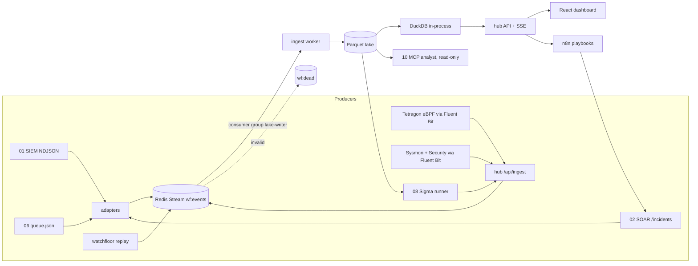

# Watchfloor architecture

## Data flow

Every arrow into the bus carries an OCSF event that passed JSON Schema validation. Mappers live at the edge
(`mappers/`), so the original projects keep their native formats (ECS in 01, their own JSON in 02, 03 and 06) and
their existing tests stay valid.

## Decisions and tradeoffs

| Decision | Why | Cost |
|---|---|---|
| OCSF subset (7 classes) instead of all of OCSF | Covers every event the projects produce; schemas stay readable and testable | Fields outside the subset go to `unmapped`; a full OCSF consumer would see fewer typed fields |
| Mappers at the edge, ECS kept inside 01 | No rewrite of tested code; each project's own test suite still passes unchanged | One more translation hop; a mapper bug shows up as a dead letter, not a crash |
| Redis Streams, not Kafka | One small container, consumer groups and acks are enough for one lab | No partitions or long retention; the lake is the system of record |
| Ack after flush | At-least-once delivery into the lake | A crash between rename and ack writes a duplicate; queries de-duplicate on `uid` where it matters (incidents use the latest row per `correlation_uid`) |
| Parquet + DuckDB, not Postgres or Elasticsearch | Zero servers, columnar scans are fast at lab scale, files are easy to ship and inspect | No concurrent writers to one file and no full-text index; compaction is a separate step |
| `time` stored as epoch ms | Matches OCSF and avoids timezone libraries in the read path | Readers convert for display |
| Static replay JSON produced by the same query code | The public demo cannot drift from the live behaviour | Replay files are snapshots and must be re-exported when datasets change |
| Read-only dashboard | Containment stays in 02, behind signed Slack/Discord approval and a hash-chained audit log | Analysts switch to chat to approve; that is intentional separation of duties |

## Scoring

A stage is **detected** when a Detection Finding whose techniques match the stage (exact, or parent and
sub-technique) arrives between one second before the stage start and fifteen minutes after it. It is
**telemetry only** when no finding matched but activity events from the stage host arrived in that window, and
**missed** otherwise. Time to detect is first matching finding minus stage start. The same rules score scenario
playback in the browser, the hub's `/api/scenarios/{id}/score`, and 07's emulation runs.

## Security

* Tokens compared with `hmac.compare_digest`; ingest needs its own token; request bodies are size-capped.
* SQL is fixed text with `?` parameters; user input never becomes SQL. DuckDB opens the lake read-only in the hub.
* Response headers: `nosniff`, `no-referrer`, a strict CSP for the dashboard, `no-store` on API responses.
* Containers run as non-root with read-only root filesystems, no capabilities and `no-new-privileges`.
* The dashboard never triggers remediation; the AI analyst has read-only tools only.
